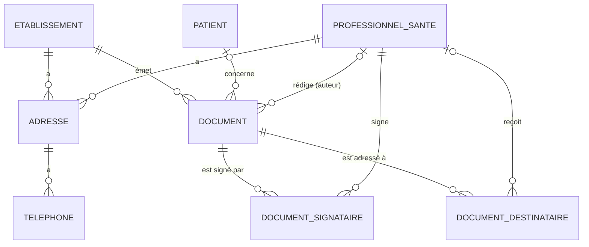

# Document, signataires et destinataires — Conception

Date : 2026-11-11
Statut : proposition soumise à revue
Branche : `feature/contrat-champs-fusion`
Lot ArchiMate : **lot 4 — Document et acteurs** (plateau 3), vues 02, 05 et 08 de
`docs/hm/migration-contrat-cdf.html`.

## 1. Objectif

Donner au POC la racine `document(id)` du contrat CDF (`docs/hm/CDF.xlsx`, feuille Types) :
signataires, destinataires, établissement émetteur, auteur et validation du document. Ces données
doivent pouvoir être insérées dans le compte rendu, rafraîchies, puis **figées à la validation** comme
les données patient.

Aujourd'hui, un « document » n'existe que sous forme de fichier `.docx` (identifié par son nom), et son
patient n'est connu qu'en lisant les tags des content controls (`StockageDocuments.patientLie`).
Il n'y a ni professionnel de santé, ni établissement en base.

### Dans le périmètre

- Tables et données fictives : établissement, professionnel de santé, adresse, téléphone, document,
  signataires, destinataires (migration V7 ; voir §9 pour la numérotation).
- Domaine et cas d'utilisation : rattachement du patient, définition des acteurs, règles de gel.
- GraphQL : `document(id)` et ses types, noms conformes au contrat CDF.
- Validation : la requête figée couvre les racines `patient` **et** `document`.
- REST + page hôte : saisie des signataires et destinataires d'un document.
- Format de liaison **v2** (spécifié ici, car la racine `document` l'exige).

### Hors périmètre (lot 5 et suivants)

- Insertion des champs `document` depuis le plugin : elle arrive avec la compilation des chemins
  imbriqués de la liaison v2 (lot 5). D'ici là, la racine est utilisable dans GraphiQL et dans la validation.
- Patient destinataire (« copie au patient »), envoi effectif (messagerie sécurisée, DMP).
- « Annule et remplace », Drimbox, immatriculations détaillées : champs du contrat **non alimentés** (§6.3).
- Lien `sejour.medecin_responsable` → professionnel (le contrat en fait un objet) : lot 6.

## 2. Décisions

| # | Décision | Raison |
|---|---|---|
| D1 | Un document a un **identifiant UUID** stable ; le nom reste unique et sert aux URL REST et au fichier. | Le nom change au renommage : il ne peut pas servir d'`ID` GraphQL ni de clé étrangère. |
| D2 | Une seule table **`professionnel_sante`**, exposée par le type GraphQL `Medecin` du contrat. `psCreateur` et `psValidant` passent du type `ProfessionnelSante` au type `Medecin` (correction à porter dans `outils/cdf/corrections.py`). | Le CDF utilise `Medecin` pour 20 champs et `ProfessionnelSante` pour 2 : il s'agit de la même notion. |
| D3 | Signataire = professionnel + **rang** ; le rang 1 est le **signataire principal**. | Le contrat distingue `signatairePrincipal`, `signatairesSecondaires[]` et `signataires[]` (tous) : un seul ordre suffit à produire les trois. |
| D4 | Destinataire = **rôle** (`PRINCIPAL`, `COPIE`, `EXTERIEUR`) + rang. `PRINCIPAL` et `COPIE` désignent un professionnel ; `EXTERIEUR` est saisi en texte libre (nom, prénom, courriel). | Correspond à `destinataire`, `destinatairesEnCopie[]`, `destinatairesExterieurs[]` du contrat. |
| D5 | Le patient du document est **enregistré en base** (`document.patient_id`) dès la première liaison patient. La validation refuse une requête portant sur un autre patient. | L'identitovigilance repose aujourd'hui sur le seul plugin. La lecture des tags (`patientLie`) reste en repli pour les anciens documents. |
| D6 | Les liaisons de la racine `document` **ne portent pas l'identifiant du document** : c'est toujours le document courant. Le serveur impose la variable `$doc` à la validation. | La duplication copie le docx : un identifiant dans le tag désignerait le document d'origine. |
| D7 | Les acteurs (signataires, destinataires, auteur, établissement, patient) sont **figés dès la validation** : toute modification renvoie 409. | Ils font partie des données figées par l'empreinte, au même titre que le nom (déjà interdit au renommage). |
| D8 | La gestion des acteurs passe par **REST** (`/api/documents/{nom}/acteurs`), pas par des mutations GraphQL. | GraphQL reste en lecture seule, comme le serveur Rapports-Metier visé (§ Périmètre du design multicontexte). |
| D9 | La validation exige un **signataire principal** et un **patient rattaché**. | Un compte rendu sans signataire ni patient n'a pas de sens médico-légal. |

## 3. Modèle de données



### Migration `V7__document_acteurs.sql`

> Le fichier `server/src/main/resources/db/migration/V7__document_acteurs.sql` fait foi : il intègre
> le rôle `PATIENT` (§10) et nomme ses contraintes. Le bloc ci-dessous est la version initiale.

Conventions du projet reprises : UUID, `varchar` + enum Java (pas de contrainte d'énumération SQL),
données fictives relatives à `current_date`.

```sql
create table etablissement (
    id       uuid primary key,
    finess   varchar(9)   not null unique,
    siret    varchar(14),
    libelle  varchar(200) not null,
    email    varchar(200)
);

create table professionnel_sante (
    id           uuid primary key,
    code         varchar(20)  not null unique,   -- code interne (Medecin.code)
    rpps         varchar(11)  unique,            -- identifiant national = '8' || rpps
    adeli        varchar(9),
    civilite     varchar(20),                    -- DOCTEUR, PROFESSEUR, MONSIEUR, MADAME
    titre        varchar(50),                    -- libellé d'édition : « Dr », « Pr »
    nom          varchar(100) not null,
    prenom       varchar(100),
    specialites  varchar(300),
    email        varchar(200),
    qualite      varchar(50),
    type_medecin varchar(20)  not null           -- ETABLISSEMENT, CORRESPONDANT
);
create index idx_ps_nom on professionnel_sante (lower(nom), lower(prenom));

create table adresse (
    id               uuid primary key,
    professionnel_id uuid references professionnel_sante (id) on delete cascade,
    etablissement_id uuid references etablissement (id) on delete cascade,
    type             varchar(20)  not null,       -- TypeAdresse : PROFESSIONNELLE, PERSONNELLE, PRINCIPALE
    ligne1           varchar(100),
    ligne2           varchar(100),
    ligne3           varchar(100),
    code_postal      varchar(10),
    ville            varchar(100),
    pays             varchar(100),
    check (num_nonnulls(professionnel_id, etablissement_id) = 1)
);
create unique index uq_adresse_ps on adresse (professionnel_id, type) where professionnel_id is not null;
create unique index uq_adresse_etab on adresse (etablissement_id, type) where etablissement_id is not null;

create table telephone (
    id        uuid primary key,
    adresse_id uuid        not null references adresse (id) on delete cascade,
    type      varchar(20)  not null,              -- TypeTelephone : FIXE, PORTABLE, FAX, PRINCIPAL…
    numero    varchar(30)  not null,
    unique (adresse_id, type)
);

create table document (
    id               uuid primary key,
    nom              varchar(64)  not null unique,     -- = NomDocument, nom du fichier
    titre            varchar(200),
    patient_id       uuid references patient (id),     -- null tant qu'aucune liaison patient
    etablissement_id uuid         not null references etablissement (id),
    auteur_id        uuid references professionnel_sante (id),   -- psCreateur
    cree_le          timestamptz  not null,
    date_valeur      timestamptz                          -- date clinique du document
);
create index idx_document_patient on document (patient_id);

create table document_signataire (
    document_id      uuid     not null references document (id) on delete cascade,
    professionnel_id uuid     not null references professionnel_sante (id),
    rang             smallint not null check (rang >= 1),     -- 1 = signataire principal
    primary key (document_id, professionnel_id),
    unique (document_id, rang)
);

create table document_destinataire (
    id               uuid primary key,
    document_id      uuid        not null references document (id) on delete cascade,
    role             varchar(20) not null,                  -- PRINCIPAL, COPIE, EXTERIEUR
    rang             smallint    not null check (rang >= 1),
    professionnel_id uuid references professionnel_sante (id),
    nom              varchar(100),                          -- EXTERIEUR uniquement
    prenom           varchar(100),
    email            varchar(200),
    id_exemplaire    varchar(30),                           -- Destinataire.idExemplaire
    check ((role = 'EXTERIEUR') = (professionnel_id is null)),
    check (role <> 'EXTERIEUR' or nom is not null),
    unique (document_id, role, rang)
);
create unique index uq_destinataire_principal on document_destinataire (document_id) where role = 'PRINCIPAL';
-- un professionnel n'est destinataire qu'une fois (pas principal ET en copie)
create unique index uq_destinataire_ps on document_destinataire (document_id, professionnel_id)
    where professionnel_id is not null;
```

**Contraintes portées par la base** : un seul signataire principal (rang unique, rang 1 = principal),
pas de double signature, un seul destinataire principal, pas de professionnel à la fois principal et en
copie, destinataire extérieur sans professionnel et avec un nom. Le domaine porte les mêmes règles
(message d'erreur métier) ; la base les garantit en dernier ressort.

**Règles portées par le seul domaine** : rangs contigus (1..n), gel après validation (D7), signataire
principal et patient requis à la validation (D9).

### Données fictives (même migration)

- 1 établissement : « Centre hospitalier POC », FINESS fictif `990000001`, adresse principale + standard.
- 6 professionnels, avec adresse professionnelle et téléphones :
  - établissement : Dr DURAND (endocrinologie), Dr LEROY (maladies infectieuses), Pr PETIT (cardiologie)
    — déjà cités en texte libre dans `sejour.medecin_responsable` (pas de « Dr POC » : le valideur est le
    signataire principal, §10) ;
  - correspondants de ville : Dr GIRARD (médecine générale), Dr ROUX (cardiologie libérale),
    Dr FAURE (endocrinologie libérale).
- FINESS, RPPS et ADELI **fictifs**, préfixés `99` pour ne jamais coïncider avec un identifiant réel.
- Aucun document : les documents sont créés par la page hôte (§7.2).

## 4. Domaine et cas d'utilisation

Aucune annotation Spring (règle du projet) ; builders pour les entités de plus de 4 champs.

```
domaine/
  document/      Document (builder), Signataire, Destinataire, RoleDestinataire,
                 ActeursDocument (signataires + destinataires, porte les règles), DocumentFige (exception)
  professionnel/ ProfessionnelSante (builder), TypeMedecin, Adresse (builder), Telephone,
                 TypeAdresse, TypeTelephone
  etablissement/ Etablissement
  port/          Documents, ProfessionnelsSante, Etablissements
application/
  GestionDocuments       créer, renommer, dupliquer, rattacher le patient, définir les acteurs
  ConsultationDocuments  lecture pour GraphQL (document, acteurs, professionnels, adresses par lots)
  ValidationCompteRendu  (modifié, §5)
```

### `ActeursDocument` — règles

Valeur immuable construite par `ActeursDocument.de(signataires, destinataires)` :

| Règle | Test |
|---|---|
| au plus un signataire par professionnel | `un_professionnel_ne_signe_pas_deux_fois_le_meme_document` |
| rangs de signature contigus à partir de 1 ; le rang 1 est le principal | `le_premier_signataire_est_le_signataire_principal` |
| au plus un destinataire principal | `un_document_n_a_qu_un_destinataire_principal` |
| un professionnel n'est pas à la fois principal et en copie | `un_destinataire_principal_n_est_pas_aussi_en_copie` |
| un extérieur n'a pas de professionnel et a un nom | `un_destinataire_exterieur_est_saisi_en_texte_libre` |
| liste vide autorisée (brouillon) | `un_brouillon_peut_n_avoir_aucun_acteur` |

### `GestionDocuments` — règles

| Opération | Règle | Test |
|---|---|---|
| `creer(nom, titre)` | crée la ligne puis le fichier ; si le fichier échoue, la ligne est supprimée | `la_creation_d_un_document_cree_sa_fiche_et_son_fichier` |
| `definirActeurs(nom, acteurs)` | refusé si validé (409) | `les_acteurs_d_un_compte_rendu_valide_sont_figes` |
| `rattacherPatient(nom, patientId)` | idempotent pour le même patient ; un autre patient est refusé dès que le document est validé ; en brouillon, le remplacement est permis (le plugin l'interdit déjà s'il reste des liaisons) | `le_patient_d_un_compte_rendu_valide_ne_change_plus` |
| `renommer` | inchangé côté règle ; met à jour `document.nom` puis déplace le fichier (retour arrière si le déplacement échoue) | `renommer_un_document_conserve_son_identifiant` |
| `dupliquer(source, nouveau)` | nouvelle ligne (nouvel id), **acteurs et patient copiés**, sans validation | `la_copie_reprend_les_acteurs_mais_pas_la_validation` |

### Documents existants (fichiers sans ligne)

`GestionDocuments.recenser()` est appelé au démarrage : chaque `.docx` sans ligne reçoit un id,
l'établissement par défaut, `cree_le` = date du fichier et le patient lu par `patientLie` (au mieux).
Les validations existantes restent dans leurs fichiers JSON (clé = nom).

## 5. Validation sur deux racines

### Requête

Le plugin compile toujours **une seule** requête `DonneesDocument`, avec les racines utilisées :

```graphql
query DonneesDocument($id: ID!, $doc: ID!) {
  patient(id: $id) { c0: nom  c1: sejourCourant { service } }
  document(id: $doc) { c2: signatairePrincipal { medecin { nom prenom } }  c3: destinatairesEnCopie { medecin { nom } } }
}
```

`$id` n'est déclaré que si la racine `patient` est utilisée ; `$doc` l'est toujours (le serveur l'impose).

### Changements côté serveur

1. **`ExecuteurRequetesDossier.executer(requete, VariablesDocument, ValidationEnCours)`** remplace
   `executer(requete, patientId)` :
   - `VariablesDocument(UUID documentId, UUID patientId)` — `documentId` vient **de la base**, jamais du client (D6) ;
   - `ValidationEnCours(Instant valideLe, UUID valideurId)` est placé dans le contexte GraphQL :
     le resolver `Document.validation` renvoie cette validation en cours quand le document n'est pas encore
     validé dans l'archive. Sans cela, les champs `document.validation.*` insérés dans le compte rendu
     seraient figés à `null` (la validation n'existe qu'après l'exécution).
2. `ExecuteurGraphQl` : la vérification `data.patient != null` devient « chaque racine déclarée est non nulle ».
3. `ValidationCompteRendu.valider` :
   1. refuse si déjà validé (inchangé) ;
   2. charge le document : refuse sans patient rattaché, ou si le patient de la demande diffère (D5, D9) ;
   3. refuse sans signataire principal (D9) ;
   4. calcule `valideLe` **avant** d'exécuter la requête (aujourd'hui calculé après) ;
   5. exécute, fige, archive. `Validation` gagne `documentId` (le nom reste la clé d'archive).
4. Valideur : reste fixe (Dr POC), mais devient un **professionnel en base** (`valideurId`) pour que
   `validation.psValidant` soit résolu. L'identité réelle viendra avec OIDC (lot 8).

Tests (cas d'utilisation, sans Spring) :
`un_compte_rendu_ne_se_valide_pas_sans_signataire_principal`,
`un_compte_rendu_ne_se_valide_pas_sans_patient_rattache`,
`la_validation_refuse_un_autre_patient_que_celui_du_document`,
`la_date_de_validation_est_celle_figee_dans_les_donnees`,
`le_document_valide_est_toujours_le_document_courant` (une variable `$doc` fournie par le client est ignorée).

## 6. GraphQL

### 6.1 Schéma (ajouts à `schema.graphqls`, noms du contrat CDF)

```graphql
extend type Query {
    "Document courant : signataires, destinataires, établissement émetteur, validation"
    document(id: ID!): Document
}

type Document {
    id: ID!
    "Titre du document"
    titre: String
    "Date de création"
    dateCreation: String
    "Heure de création"
    heureCreation: String
    "Date de valeur"
    dateValeur: String
    "Heure de valeur"
    heureValeur: String
    "Auteur du document"
    psCreateur: Medecin
    "Établissement émetteur"
    etablissement: Etablissement
    "Signataire principal"
    signatairePrincipal: Signataire
    "Signataires secondaires"
    signatairesSecondaires: [Signataire!]!
    "Signataires (principal en premier)"
    signataires: [Signataire!]!
    "Destinataire principal"
    destinataire: Destinataire
    "Destinataires en copie"
    destinatairesEnCopie: [Destinataire!]!
    "Destinataires extérieurs"
    destinatairesExterieurs: [DestinataireExterieur!]!
    "Validation du document"
    validation: ValidationDocument
}

type Signataire {
    "Professionnel signataire"
    medecin: Medecin!
    "Identifiant national transcodé"
    rppsTranscode: String
}

type Destinataire {
    "Professionnel destinataire"
    medecin: Medecin
    "Civilité"            civilite: String
    "Nom"                 nom: String
    "Prénom"              prenom: String
    "Libellé (titre, nom, prénom)" libelle: String
    "Code"                code: String
    "Identifiant national" identifiantNational: String
    "Spécialités"         specialites: String
    "Courriel"            email: String
    "Téléphone"           telephone: String
    "Autre téléphone"     telephoneAutre: String
    "Télécopie"           fax: String
    "Adresse"             adresse: Adresse
    "N° ID exemplaire"    idExemplaire: String
}

type DestinataireExterieur { "Nom" nom: String!  "Prénom" prenom: String  "Courriel" email: String }

type Medecin {
    "Code"                    code: String!
    "Titre médecin"           titre: String
    "Nom"                     nom: String!
    "Prénom"                  prenom: String
    "Courriel"                email: String
    "Qualité du P.S."         qualite: String
    "Type de médecin"         typeMedecin: String
    "Spécialités"             specialitesConcatenees: String
    "Identifiant national transcodé" rppsTranscode: String
    "Identifiant national"    identifiantNationalActif: IdentifiantNational
    "Immatriculations"        immatriculations: [Immatriculation!]!
    "Adresse"                 adresse(type: TypeAdresse = PROFESSIONNELLE): Adresse
}

type IdentifiantNational { "Identifiant national" identifiantNational: String  "Identifiant national transcodé" rppsTranscode: String }
type Immatriculation { "ADELI" adeli: String }

type Etablissement {
    "Libellé" libelle: String!   "FINESS" finess: String!   "SIRET" siret: String   "Courriel" email: String
    "Adresse" adresse: Adresse
    "Téléphone principal" telephonePrincipal: Telephone
    "Téléphone secondaire" telephoneSecondaire: Telephone
}

type Adresse {
    "Ligne 1" ligne1: String  "Ligne 2" ligne2: String  "Ligne 3" ligne3: String
    "Code postal" codePostal: String  "Ville" ville: String  "Pays" pays: String
    "Téléphone" telephone(type: TypeTelephone = FIXE): Telephone
}
type Telephone { "Numéro" numero: String! }

type ValidationDocument {
    "Date de validation"  dateValidation: String!
    "Heure de validation" heureValidation: String!
    "Professionnel validant" psValidant: Medecin
}

enum TypeAdresse { "Professionnelle" PROFESSIONNELLE "Personnelle" PERSONNELLE "Principale" PRINCIPALE "Naissance" NAISSANCE }
enum TypeTelephone { "Fixe" FIXE "Portable" PORTABLE "Personnel" PERSONNEL "Principal" PRINCIPAL "Télécopie" FAX "Autre" AUTRE }
```

(Descriptions abrégées ici sur une ligne ; dans le fichier, une description par ligne comme le reste du schéma.)

### 6.2 Resolvers et chargeurs (pas de N+1)

| Champ | Chargeur (clé) | Requêtes SQL par document, quel que soit le nombre de liaisons |
|---|---|---|
| `Query.document` | — | 1 |
| `signatairePrincipal`, `signatairesSecondaires`, `signataires` | `signataires` (documentId) — partagé, comme `sejours` / `sejourCourant` | 1 |
| `destinataire`, `destinatairesEnCopie`, `destinatairesExterieurs` | `destinataires` (documentId) — partagé | 1 |
| `*.medecin`, `psCreateur`, `psValidant` | `professionnels` (id) | 1 |
| `*.adresse(type)` | `adresses` (propriétaire, type) | 1 |
| `Adresse.telephone(type)` | `telephones` (adresseId, type) | 1 |
| `etablissement` | `etablissements` (id) | 1 |

Test de tranche `@GraphQlTest` : `les_acteurs_d_un_document_se_chargent_sans_n_plus_1` (compte les appels
aux ports bouchonnés pour un document à 5 signataires et 4 destinataires).

Champs calculés : `identifiantNational = '8' + rpps` ; `Destinataire.libelle = titre + nom + prénom` ;
champs `Destinataire.*` délégués au professionnel ; `heure*` / `date*` formatés depuis les `timestamptz`
(Europe/Paris).

### 6.3 Champs du contrat non alimentés dans ce lot

Déclarés dans le schéma mais résolus à `null` (resolver explicite) : `Medecin.rppsTranscode`,
`Signataire.rppsTranscode`, `IdentifiantNational.rppsTranscode` (sémantique « transcodé » à préciser),
`ValidationDocument.psValidant` (alimenté à l'étape 5, valideur = signataire principal).
`Immatriculation` n'expose que `adeli`.

**Non déclarés** (écart à la proposition initiale, réalisé ainsi) : les champs PS « à plat » de
`Document` et `ValidationDocument` (`codePs`, `civilitePs`, `nomPrenomPs`, `categoriePs`,
`identifiantNationalPs`, `loginCreateur`), doublons de `psCreateur` / `psValidant` hérités de
l'extraction CDF ; `annuleEtRemplace`, `validationParOrdre`, `actesDrimbox`, `Medecin.image`. Les
déclarer sans les alimenter n'apporterait rien tant que le plugin n'insère pas de champ `document`
(lot 5) ; ils seront ajoutés, ou dépréciés dans le contrat, à ce moment-là.

### 6.4 Chargement groupé — réalisé

Quatre chargeurs : acteurs (par document), professionnels, coordonnées (adresses et téléphones d'un
propriétaire, lus ensemble) et établissements. Aucun champ n'enchaîne deux chargeurs : un chargement
lancé après la répartition d'un niveau ne serait pas groupé. Le test
`le_nombre_de_lectures_ne_depend_pas_du_nombre_d_acteurs` compare un document à 2 acteurs et un
document à 12 : mêmes lectures, une par niveau de requête.

## 7. REST et page hôte

### 7.1 API (contrôleur `ControleurDocuments`, ou un `ControleurActeurs` dédié)

| Méthode | URL | Corps / réponse | Erreurs |
|---|---|---|---|
| `GET` | `/api/professionnels?texte=` | `[ {id, code, titre, nom, prenom, specialites, typeMedecin} ]` (2 caractères min.) | — |
| `GET` | `/api/documents/{nom}/acteurs` | `{ signataires: [id…], destinataire: id?, copies: [id…], exterieurs: [{nom, prenom, email}] }` | 404 |
| `PUT` | `/api/documents/{nom}/acteurs` | même forme, **remplacement complet** | 409 validé, 400 règle |
| `PUT` | `/api/documents/{nom}/patient` | `{ patientId }` | 409 autre patient sur un document validé |
| `GET` | `/api/documents` | + `id` du document et nombre de signataires | — |
| `GET` | `/api/documents/{nom}/configuration` | + `documentId` dans `editorConfig` (lu par le plugin, remplace à terme `window.top.PocCr.documentCourant`) | — |

### 7.2 Page hôte

Bouton « Acteurs » sur chaque ligne de la liste des documents, ouvrant un panneau :
signataire principal, signataires secondaires (ordre modifiable), destinataire principal, copies
(recherche de professionnels), destinataires extérieurs (saisie libre). Panneau en lecture seule pour un
document validé. Pas de `confirm()` : enregistrement explicite, comme le reste de la page.

### 7.3 Plugin, dans ce lot

- Appelle `PUT /patient` au premier verrouillage du patient (D5).
- Lit `documentId` dans la configuration et envoie la requête de validation avec la racine `document`
  quand elle est utilisée (rien à faire tant que le plugin n'insère pas encore de champ `document`).

## 8. Liaison v2 (format)

La racine `document` ne tient pas dans le format v1 (`c` = champ de `Patient`). Le format v2 est donc
fixé maintenant, pour ne pas en changer deux fois ; le plugin le **produira** au lot 5, et lira toujours v1.

```json
{"v":2,"r":"document","c":"signatairePrincipal.medecin.adresse.ville","a":{"2":{"type":"PROFESSIONNELLE"}},"m":"i","f":12345}
{"v":2,"r":"patient","p":"1111…","c":"sejourCourant.actesCcam","k":["code","medecinRemplacant.nom"]}
```

| clé | sens | v1 |
|---|---|---|
| `v` | 2 | 1 |
| `r` | racine : `patient` ou `document` | implicite `patient` |
| `p` | patient ; **interdit** si `r` = `document` (D6) ; absent = gabarit | idem |
| `c` | chemin depuis la racine, segments séparés par `.` | champ de `Patient` (+ `s`) |
| `a` | arguments **par position de segment** (`"0"`, `"1"`…) | arguments de `c` |
| `k` | colonnes : sous-chemins relatifs au dernier segment liste de `c` | noms de colonnes |
| `m`, `g`, `q` | inchangés (`g` : champ enum terminal ; `q` : `c` se termine sur une liste) | idem |
| `f` | `CHAMP_ID` du CDF, pour la traçabilité (facultatif, ignoré à la compilation) | — |

Lecture d'un tag v1 : `{v:1, c, s}` est lu comme `{v:2, r:"patient", c: s ? c + "." + s : c}`.
Les arguments par position (et non par préfixe de chemin) gardent le tag court ; la longueur de tag
conservée par Word reste à vérifier sur la vraie version (point déjà ouvert dans `CLAUDE.md`).

## 9. Impacts et ordre de réalisation

| # | Étape | Fichiers principaux | Vérification |
|---|---|---|---|
| 0 | Prérequis : `mvn verify` vert (lot 1) | — | build |
| 1 | Migration + données fictives | `db/migration/V7__document_acteurs.sql` | exécution sur PostgreSQL 16 |
| 2 | Domaine + cas d'utilisation | `domaine/document`, `domaine/professionnel`, `domaine/etablissement`, `application/GestionDocuments` | tests JUnit des règles §4 |
| 3 | Adaptateurs JDBC + recensement au démarrage | `infrastructure/persistance/*Jdbc`, `configuration/ConfigurationPersistance` | requêtes SQL sur PostgreSQL réel |
| 4 | GraphQL `document(id)` + chargeurs | `schema.graphqls`, `infrastructure/graphql/ControleurDocument` | `@GraphQlTest`, GraphiQL |
| 5 | Validation sur deux racines | `ExecuteurGraphQl`, `ValidationCompteRendu`, `Validation` | tests §5 |
| 6 | REST + page hôte | `ControleurDocuments`, `static/index.html` | parcours manuel |
| 7 | Plugin : `PUT /patient`, `documentId` | `static/plugin/scripts/code.js` | tests Node |
| 8 | Contrat : D2 dans `outils/cdf/corrections.py`, régénération de `CDF.xlsx` ; `CLAUDE.md` (format v2, invariants D5–D7) | — | relecture |

**Numérotation des migrations** : les vues ArchiMate prévoyaient V7 pour le catalogue CDF et V8 pour ce
lot. Le catalogue (lot 3) n'étant pas commencé, ce lot prend **V7** ; le catalogue prendra le numéro
suivant. Les vues seront mises à jour avec le code.

**Nouveaux invariants à inscrire dans `CLAUDE.md`** :
- les liaisons `document` ne portent jamais d'identifiant : le document est le document courant, imposé
  par le serveur à la validation ;
- les acteurs et le patient d'un compte rendu validé sont figés ;
- pas de validation sans patient rattaché ni signataire principal.

## 10. Décisions prises en revue (2026-11-11)

1. **Valideur = signataire principal** en attendant OIDC : `ValidationCompteRendu` prend le signataire
   principal du document comme valideur (`valideurId`, `validePar` = son libellé) ; « Dr POC » disparaît.
2. **Duplication** : la copie reprend le patient, les signataires et les destinataires, sans la validation.
3. **Copie au patient** : nouveau rôle de destinataire `PATIENT`, sans professionnel, désignant le
   patient du document (au plus un par document). Contraintes ajustées en conséquence :
   `check ((role in ('EXTERIEUR','PATIENT')) = (professionnel_id is null))`,
   `check (role <> 'EXTERIEUR' or nom is not null)`,
   `create unique index uq_destinataire_patient on document_destinataire (document_id) where role = 'PATIENT'`.
   Côté GraphQL : `Document.destinatairePatient: Boolean!` (le patient lui-même reste lu par la racine
   `patient`). Les coordonnées du patient ne sont pas recopiées : elles viennent de son dossier.

## 11. Questions encore ouvertes

1. **Destinataire non professionnel de santé mais connu** (établissement, service, organisme) :
   aujourd'hui seul le texte libre (`EXTERIEUR`) le permet.
